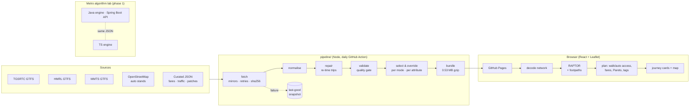

# Hyderabad Transit Planner

Point A to point B anywhere in Hyderabad, using **TGSRTC city buses, the Metro, MMTS trains,
autos and cabs** in one search. Options are ranked by arrival time, cost, number of changes and
walking. The data rebuilds itself **every day** from official open timetables. A validation and
repair pipeline catches broken source data before it reaches users, and when a newer or more
trusted source appears, it overrides the old one automatically with the change logged. Routing
runs entirely in your browser (RAPTOR, the algorithm family behind real journey planners), so
the site is free to host and never goes to sleep.

The repo also contains the **Metro algorithm lab** (phase 1): Dijkstra, A*, 0-1 BFS and Pareto
search written from scratch in Java, with a step-by-step search visualiser.

> **Live:** https://adhrit15.github.io/hyderabad-transit-planner/ (rebuilt every day at 06:00 IST)


## What it does
- **Multimodal journeys:** walk → bus → metro → MMTS → auto, in any combination, with real departure times and up to 4 changes.
- **First and last mile:** walking (≤1.2 km), or an auto to the nearest metro/MMTS station when you are far from one. Share-auto hints near known auto points.
- **Door-to-door alternatives:** walking, metered auto (government tariff, with night surcharge) and an app-cab price range by time of day.
- **Ranked results:** *Fastest*, *Cheapest*, *Fewest changes* and *Least walking*, plus every other non-dominated option.
- **Honest data:** every estimated time or fare is labelled. The **Data sources** panel shows each feed's freshness, validity dates, repairs and overrides.
- **Find any place:** 5,100+ stops and stations plus ~8,600 named places from OpenStreetMap (areas, malls, hospitals, colleges, IT parks, landmarks) work instantly, even offline. Live suggestions while you type (Photon) and a full address search (Nominatim) cover the rest, with no API key. You can also click the map or use your location.
- **Shareable links:** `#plan&f=lat,lon,name&t=…`.

## What the data pipeline found (and fixed) in the official feeds
| Problem in source data | How the pipeline handles it |
|---|---|
| **93% of TGSRTC bus trips** have impossible stop times. Gaps between stops grow 1 → 77 min, and a city bus "arrives" at 34:38. | Keep each trip's stop sequence and first departure, then **re-time** it from distance, a time-of-day bus speed and stop dwell. These trips are flagged "times estimated". |
| HMRL's weekday service is marked as running 7 days, beside separate Saturday/Sunday timetables. | A reviewed **patch** (`manual/patches.json`) makes it Mon–Fri. The patch reports itself obsolete once HMRL fixes the feed. |
| HMRL's GTFS fare table is the 2017 chart (₹10–60). | The **override rule** (newest effective date wins) applies the May 2025 chart (₹11–69) and logs the decision. |
| The MMTS timetable expired in April 2020. | Used as the last known schedule, with every MMTS leg flagged. Adding a newer MMTS feed replaces it automatically. |
| A feed download fails or returns garbage. | The pipeline falls back to the **last-good snapshot**. With no usable data at all, the build fails and the live site keeps the previous version. |

## Architecture



## Run it locally
```bash
cd pipeline && npm install && npm run build
```
```bash
cd frontend && npm install && npm run dev
```
The first command downloads the official feeds (~14 MB) and writes `frontend/public/data/`. Open http://localhost:5173.
The Java API for the metro lab is optional: `cd backend && ./gradlew bootRun`, or `docker compose up --build`.

**Tests:**
```bash
cd pipeline && npm test
```
```bash
cd frontend && npm test
```
```bash
cd backend && ./gradlew test
```

## Deploy (free, self-updating)
1. Push this repo to GitHub.
2. Go to **Settings → Pages → Source: GitHub Actions**.
3. The `Refresh data and deploy` workflow runs on every push and **daily at 06:00 IST**. It rebuilds
   the data, runs all tests, deploys, and commits a line to [pipeline/state/CHANGELOG.md](pipeline/state/CHANGELOG.md) whenever the data changed.

## Add or correct data
- **New feed** (for example an updated MMTS timetable): add an entry to [pipeline/sources.json](pipeline/sources.json) with `covers: ["mmts"]`. If its calendar is active, it supersedes the expired one.
- **New fare chart:** edit the matching `pipeline/manual/*-fares.json` with a new `effectiveFrom`.
- **Fix a source error:** add a reviewed entry to `pipeline/manual/patches.json`.
- **Share-auto stand:** add a row to `pipeline/manual/auto-points.csv`.

## Algorithms
| Where | Algorithm | Notes |
|---|---|---|
| Trip planner | **RAPTOR** (round-based public transit routing) | Pareto over (arrival, rides) in O(K·(Σ pattern length + footpaths)); no priority queue; checked against time-dependent Dijkstra on 200 random timetables |
| Trip planner | Multi-criteria filtering | Keeps journeys not dominated on (arrival, cost, changes, walking) |
| Pipeline | FIFO pattern splitting | Splits trips that overtake each other into separate patterns, so RAPTOR can binary-search the earliest trip |
| Metro lab | Dijkstra (own indexed binary heap), A*, 0-1 BFS, fare-constrained label-setting, Pareto | 189 JUnit tests, including randomised checks against Floyd–Warshall and brute force |

## Résumé bullet
> Built a self-updating multimodal journey planner for Hyderabad (bus, metro, MMTS, auto/cab) that serves 5,100+ stops and
> 47,000+ daily trips from official GTFS feeds. Wrote a Node data pipeline that validates, repairs (re-timing 93% of bus trips
> with impossible published times), merges sources by recency and trust with logged overrides, and redeploys daily with
> last-good fallback. Implemented RAPTOR in TypeScript, running in the browser (~0.3 s per query, verified against time-dependent
> Dijkstra), plus a Java/Spring Boot graph-algorithm engine (Dijkstra on a custom heap, A*, 0-1 BFS, Pareto) with 189 tests.

## Documents
- [REPORT.md](REPORT.md): the learning report (phase 1 metro algorithms, phase 2 data pipeline and RAPTOR)
- [DATA_SOURCES.md](DATA_SOURCES.md): every source, what is verified or approximate, licences
- [PLAN.md](PLAN.md): the plans for both phases
- [docs/benchmark-output.txt](docs/benchmark-output.txt), [docs/api-examples](docs/api-examples): metro lab benchmark and API samples
