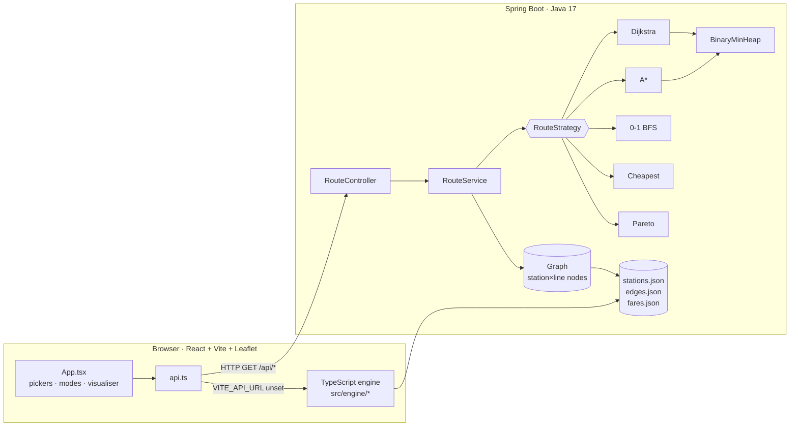

# Hyderabad Metro Route Planner

A full-stack route planner for the Hyderabad Metro (Red, Blue and Green lines). It shows graph
algorithms at work: Dijkstra, A*, 0-1 BFS, a fare-constrained cheapest-route search and
multi-criteria Pareto search. All of them are written from scratch in Java, with no graph
libraries, on top of my own indexed binary heap. They are served by a Spring Boot REST API and
drawn on a React + Leaflet map. A **search visualiser** replays every algorithm step by step:
nodes are settled, the frontier grows, and the search tree spreads across the city.

> **Live demo:** _add your GitHub Pages link here after the first deploy:_ `https://<your-username>.github.io/<repo>/`


## Features
- **5 routing modes:** fastest (Dijkstra), A* (haversine heuristic), fewest changes (0-1 BFS),
  cheapest (fare slabs, ties broken by time) and Pareto (every non-dominated time/transfer trade-off).
- **(station, line) graph model:** changing lines is an explicit, costed edge (5 min by default,
  configurable).
- **Search visualiser:** play, pause, step, scrub and change speed, with live counters for nodes
  expanded and frontier size.
- **Compare view:** every mode side by side, plus nodes expanded by Dijkstra vs A* for the same query.
- **Real data:** 56 stations; HMRL fare chart effective 24 May 2025 (₹11–₹69). See [DATA_SOURCES.md](DATA_SOURCES.md).
- **REST API:** validation, RFC 7807 problem+json errors, OpenAPI/Swagger UI.
- **Two engines, one contract:** the frontend calls the Java API, or runs a TypeScript port of the
  engine in the browser. That port lets the demo be hosted for free as a static site.
- **Tested:** 189 JUnit tests (randomised checks against Floyd–Warshall and brute force) and 13 Vitest parity tests.

## Architecture



## Run it

**One command (Docker):**
```bash
docker compose up --build
```
The web app is at http://localhost:5173, the API at http://localhost:8080/api/stations and
Swagger at http://localhost:8080/swagger-ui.html.

**Or with two terminals** (needs JDK 17+ and Node 20+):
```bash
cd backend && ./gradlew bootRun
```
```bash
cd frontend && npm install && VITE_API_URL=http://localhost:8080 npm run dev
```
If you leave out `VITE_API_URL`, the frontend uses the in-browser engine and needs no backend at all.

**Tests and benchmark:**
```bash
cd backend && ./gradlew test bench
```
```bash
cd frontend && npm test
```

## Deploy the public demo (free, GitHub Pages)
1. Create an empty GitHub repo and push this project to it (`git remote add origin … && git push -u origin main`).
2. In the repo, open **Settings → Pages → Build and deployment → Source: GitHub Actions**.
3. The `Deploy to GitHub Pages` workflow builds the frontend on every push to `main` and publishes it at
   `https://<user>.github.io/<repo>/`. The workflow also fills in the "Source code" link in the app footer.

## API examples
```http
GET /api/route?from=raidurg&to=mg-bus-station&mode=fastest
```
```json
{ "mode": "fastest", "found": true, "totalMinutes": 38.1, "km": 18.6, "transfers": 1, "fare": 61,
  "legs": [ { "lineName": "Blue Line", "towards": "Nagole", "minutes": 18.0, "stations": [ "…10 stations…" ] },
            { "lineName": "Red Line",  "towards": "LB Nagar", "minutes": 15.1, "stations": [ "…10 stations…" ] } ],
  "instructions": [ "Board the Blue Line at Raidurg towards Nagole.", "Ride 9 stops (18 min).",
                    "Change at Ameerpet → Red Line towards LB Nagar (≈5 min walk + wait).", "Ride 9 stops (15.1 min).",
                    "Alight at MG Bus Station." ],
  "nodesExpanded": 37, "runtimeMicros": 1316 }
```
Other endpoints: `GET /api/stations`, `GET /api/compare?from=raidurg&to=lb-nagar`, and `&trace=true`
on `/api/route` (returns the event list the visualiser replays). Errors look like
`404 {"title":"Station not found","detail":"Unknown station: atlantis"}`. Full captured responses
are in [docs/api-examples](docs/api-examples).

## Algorithms at a glance
| Mode | Algorithm | Cost minimised | Time complexity |
|---|---|---|---|
| `fastest` | Dijkstra + indexed binary heap (decrease-key) | minutes | O((V+E) log V) |
| `astar` | A*, h = straight-line km ÷ 80 km/h (admissible, consistent) | minutes | O((V+E) log V), fewer expansions |
| `fewest-transfers` | 0-1 BFS with a deque (transfer = 1, ride = 0), ties broken by minutes | (transfers, minutes) | O(V+E) for transfers alone |
| `cheapest` | Dijkstra on km → minimum fare slab, then a km-capped label-setting search for the fastest route in that slab | (fare, minutes) | label-setting, small in practice |
| `pareto` | Bi-criteria label-setting | all non-dominated (minutes, transfers) | O(T·(V+E) log(TV)), T = max transfers |

## Benchmark (`./gradlew bench`, JDK 25, Windows laptop)
100 random queries on the metro graph (59 nodes, 118 edges):

| Strategy | avg nodes expanded | avg µs / query |
|---|---:|---:|
| Dijkstra (fastest) | 29.9 | 8.3 |
| A* (haversine) | **23.9** (−20%) | 9.9 |
| 0-1 BFS | 60.1 | 7.4 |
| Cheapest | 59.5 | 28.2 |
| Pareto | 35.3 | 20.8 |
| Dijkstra, `PriorityQueue` + lazy deletion | 29.9 | 6.9 |

Heap comparison on a 120×120 synthetic grid (28,800 nodes, 85,920 edges, 200 queries):
`BinaryMinHeap` **3.37 ms** vs `PriorityQueue` + lazy deletion **4.01 ms** per query (16% faster).
A* expands 21% fewer nodes there (11,214 vs 14,281), but it is slower in wall-clock time,
because the trigonometry in each haversine call costs more than the nodes it saves.
REPORT.md §7 discusses why.

## Résumé bullet
> Built a full-stack Hyderabad Metro route planner (Java 17, Spring Boot, React, Leaflet) with 5 from-scratch graph
> algorithms (Dijkstra on a custom indexed binary heap, A*, 0-1 BFS, fare-constrained label-setting, Pareto
> multi-criteria search) on a (station, line) graph. Added a step-by-step search visualiser; checked correctness with 189 JUnit
> tests, including randomised differential testing against Floyd–Warshall and brute force; the custom heap is 16% faster than
> `PriorityQueue` with lazy deletion. Shipped with CI, Docker and a static GitHub Pages deployment.

## Documents
- [PLAN.md](PLAN.md): the original plan
- [REPORT.md](REPORT.md): **the learning report** (algorithms worked by hand, design decisions, interview prep, exercises)
- [DATA_SOURCES.md](DATA_SOURCES.md): what is verified and what is approximate
