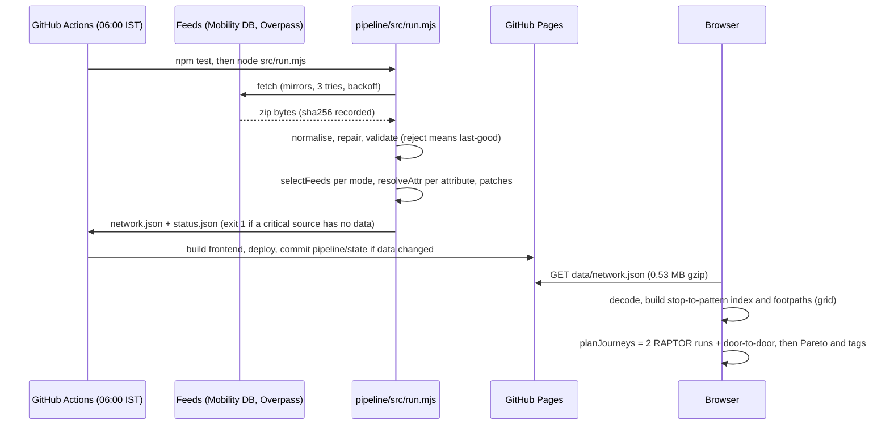

# REPORT: Hyderabad Metro Route Planner (learning report)

This report is written for you, a 2nd-year CSE student, to read after the build. Read it top to
bottom once, then use §4 and §8 as revision notes. File links point at the exact code.

---

## 1. Summary

1. **Built:** a Java 17 graph engine with 5 route strategies (Dijkstra, A*, 0-1 BFS, Cheapest, Pareto),
   my own indexed `BinaryMinHeap`, a Spring Boot REST API, and a React + Leaflet frontend with a search visualiser.
2. **The graph:** 56 stations become 59 nodes, because each (station, line) pair is a node and the 3
   interchanges each count twice. There are 118 directed edges: ride edges plus 5-minute transfer edges.
3. **Works:** all 5 modes for Miyapur → LB Nagar (0 changes, 51.7 min, ₹69) and Raidurg → MGBS (1 change at Ameerpet, 38.1 min, ₹61).
4. **Tests:** 189 JUnit tests and 13 Vitest tests, all passing. They include randomised differential tests:
   Dijkstra and A* against Floyd–Warshall; 0-1 BFS, Cheapest and Pareto against brute-force enumeration of all paths.
5. **Benchmark:** my heap is ~16% faster than `PriorityQueue` with lazy deletion on a 28,800-node grid; A* expands 20% fewer nodes than Dijkstra on the metro.
6. **Public demo:** the frontend also contains a **TypeScript port** of the engine, so it runs as a static site
   (GitHub Pages workflow included) with no server. The output matches Java exactly (same times, fares and nodes-expanded).
7. **Approximate:** station coordinates, per-segment km and minutes (see §6). Station lists and fares are verified.
8. **Not verified here:** `docker compose up` (Docker is not installed on this machine), and the GitHub Actions
   runs (the repo has not been pushed yet). Both files are written and reviewed but have never been executed.
9. **Not done:** the Java backend is not hosted publicly (that needs a paid or free-tier server account); the public demo uses the TS engine.
10. **Read first:** §4.0 (the graph model), then §4.1 Dijkstra, then §8 interview prep.

---

## 2. Timeline of what I did

| # | Commit | What changed | Problems hit → fix |
|---|---|---|---|
| 1 | `ad1692d` | PLAN.md, .gitignore, Gradle wrapper (9.1.0) | No `java`/`gradle` on PATH. Found the JDK 25 bundled with Android Studio and a cached Gradle 9.1 distribution, and used them to generate the wrapper. |
| 2 | `4cd7395` | `.gitattributes` (LF endings), `gradlew` marked executable | Windows checked files out with CRLF, which would break `./gradlew` on Linux CI. |
| 3 | `3248738` | `stations.json`, `edges.json`, `fares.json`, DATA_SOURCES.md, generator script | **Failed approach:** a fixed "detour factor" of 1.15 × straight-line distance made the Red Line 31.5 km against a published 29.2 km. **Fix:** scale each line so its total equals the published length (factor ≥ 1 is checked, which keeps A* admissible). |
| 4 | `bb3b64c` | `Station`, `Line`, `Node`, `Edge`, `Graph`, `GraphLoader`, `FareCalculator` | Planned package `in.metro`, but `in` is a Java keyword, so I used `com.hydmetro`. **Big one:** Gradle reported `ClassNotFoundException` for test classes that existed. The folder name `Djikstra's` contains an apostrophe, which breaks Gradle's test-worker classpath. Fix: build.gradle moves the build directory to the temp folder **only** when the path contains `'`. |
| 5 | `5b28e58` | `BinaryMinHeap` + 55 tests (50 randomised) | none |
| 6 | `b488370` | `RouteStrategy`, `Path`, `SearchResult`, `TraceEvent` | none |
| 7 | `122f2b0` | Dijkstra (shared `BestFirstSearch`), lazy-PQ baseline, Floyd–Warshall oracle | none |
| 8 | `7a066e2` | A* | none |
| 9 | `ad4fa9b` | 0-1 BFS | Plain 0-1 BFS can't break ties by time. I made it label-correcting (see §4.3). |
| 10 | `97115f6` | Cheapest + Pareto via shared `BiCriteriaLabelSetting` | I first considered "cheapest = shortest km". That is wrong: a longer route in the **same fare slab** can be faster. I switched to a two-phase approach (§4.4), and a test pins this case. |
| 11 | `9f06804` | Toy-graph, randomised and real-data tests | All 179 passed on the first run. |
| 12 | `0039b22` | `./gradlew bench` | `µ` and `×` printed as garbage in the Windows console (code page), so I switched to ASCII. |
| 13 | `877bc59` | Spring Boot API, validation, problem+json, OpenAPI, 10 MockMvc tests | none |
| 14 | `40a0b89` | `order` field on stations; captured API examples | The map drew each line by filtering stations in JSON order. Interchanges appear earlier in the file (under Red), so the Blue line would have jumped back to Ameerpet. Fix: expose each station's position on each line. |
| 15 | `a04c8c6` | TypeScript engine port + Vitest parity tests | Port checked against Java: Raidurg→MGBS = 38.1 min, ₹61, **37 nodes expanded** in both. |
| 16 | `2eb233a` | React UI: map, pickers, route panel, visualiser, compare | Shared links (`#from=…`) pasted into an open tab didn't reload the route. Fixed with a `hashchange` listener. |
| 17 | `68e5394` | CI, Pages deploy, Dockerfiles, docker-compose | Docker is not installed here, so the compose setup is **untested**. |
| 18 | `eb0b6fd` | Schematic "no tiles" mode, single-file build for the claude.ai demo | That host blocks external images (no OSM tiles) and wraps pages in its own `<html>`. A build flag `VITE_TILES=off` and `tools/build-artifact.mjs` handle it. |
| 19 | (this commit) | README, REPORT | none |

Run `git log --stat` to see exactly which files each step touched.

---

## 3. Architecture walkthrough

```mermaid
flowchart TB
  click[User clicks 'Find route'] --> App[App.tsx find()]
  App --> apiTs[api.ts]
  apiTs -- VITE_API_URL set --> HTTP[GET /api/route?from&to&mode&trace]
  apiTs -- not set --> TSE[engine/service.ts → algorithms.ts]
  HTTP --> Ctl[RouteController<br/>@Validated params]
  Ctl --> Svc[RouteService.route]
  Svc --> Reg[Strategies map: mode → RouteStrategy]
  Reg --> Strat[e.g. DijkstraStrategy.search]
  Strat --> Heap[BinaryMinHeap]
  Strat --> Graph[(Graph)]
  Strat --> Res[SearchResult: Path + nodesExpanded + trace]
  Res --> Svc2[RouteService builds legs, instructions, fare]
  Svc2 --> JSON[RouteResponse JSON]
  Ctl -. exception .-> GEH[GlobalExceptionHandler → 400/404 problem+json]
  JSON --> App2[App.tsx state] --> Map[MetroMap draws route] & Panel[RoutePanel] & Vis[useTracePlayer replays trace]
```

### Folders and key files
```
backend/
  build.gradle                    Spring Boot 3.5, Java 17 bytecode, `bench` task
  src/main/resources/data/        stations.json, edges.json, fares.json (generated)
  src/main/resources/application.properties   port, transfer minutes, CORS
  src/main/java/com/hydmetro/
    MetroApplication.java         Spring Boot entry point
    model/   Station, Line, Node(station×line), Edge(RIDE|TRANSFER), Graph(+Builder), GraphLoader
    fare/    FareCalculator: slab lookup, slabUpperBoundKm
    heap/    BinaryMinHeap: array heap + pos[] index map
    algo/    RouteStrategy (interface), BestFirstSearch (Dijkstra & A* core), DijkstraStrategy,
             AStarStrategy, ZeroOneBfsStrategy, BiCriteriaLabelSetting, CheapestStrategy,
             ParetoStrategy, LazyDijkstraStrategy (baseline), Strategies (registry), Path, SearchResult, TraceEvent
    service/ RouteService: runs strategies, times them, converts paths to legs and instructions
    api/     RouteController, Dtos, GlobalExceptionHandler, WebConfig (CORS)
    bench/   Benchmark: ./gradlew bench
  src/test/java/com/hydmetro/
    heap/BinaryMinHeapTest        unit + randomised vs PriorityQueue
    algo/FloydWarshall            O(V³) oracle (test-only)
    algo/TestGraphs               toy graph, random graphs, brute-force path enumerator
    algo/ToyGraphTest             known answers + edge cases for every strategy
    algo/RandomisedCorrectnessTest  differential tests
    algo/MetroDataTest            definition-of-done routes on real data
    api/RouteControllerTest       HTTP status codes, JSON shape, OpenAPI
frontend/
  src/engine/  types.ts (JSON contract), graph.ts, heap.ts, algorithms.ts, service.ts, engine.test.ts
  src/api.ts   picks Java API or the in-browser engine
  src/App.tsx  page state, URL hash, layout
  src/components/ StationPicker, MetroMap, RoutePanel, ComparePanel, VisualiserControls, useTracePlayer
tools/generate-data.mjs   regenerates the JSON data
tools/build-artifact.mjs  single-file build for sandboxed hosts
.github/workflows/ci.yml, pages.yml
docker-compose.yml, backend/Dockerfile, frontend/Dockerfile
```

### A request, end to end
1. You click **Find route**. `App.tsx` calls `api.route(from, to, mode, true)` and `api.compare(...)`.
2. `api.ts`: if `VITE_API_URL` is set, it issues `fetch` to the backend; otherwise it calls `localEngine.route` (same JSON shape).
3. Backend: Spring routes `GET /api/route` to [RouteController.route](backend/src/main/java/com/hydmetro/api/RouteController.java).
   Bean Validation checks the ids against `^[a-z0-9-]{1,64}$` and the mode against the 5 allowed values. A failure throws an exception and returns **400**.
4. [RouteService.route](backend/src/main/java/com/hydmetro/service/RouteService.java) looks up the strategy, starts a timer, and calls `search(graph, from, to, options)`.
5. The strategy validates the station ids (`graph.nodesOf` throws `UnknownStationException`, which becomes **404**) and runs.
6. `RouteService` converts `Path` (node indices) into **legs**: maximal runs of consecutive nodes on one line. It adds "towards X"
   (by comparing station order on the line), instructions, the fare (`FareCalculator.fareFor(km)`) and, optionally, the trace.
7. Jackson serialises the `RouteResponse` record to JSON.
8. React stores it. `MetroMap` draws the legs. If "Show search" is on, `useTracePlayer` replays `trace[]`:
   each `settle` event colours a station amber, each `relax` adds it to the purple frontier, and each settle's `from` field adds a dotted search-tree edge.

---

## 4. Algorithms explained from first principles

### 4.0 The (station, line) graph model: why it matters
If each **station** were one node, Ameerpet would be a single node touching both Red and Blue edges.
A route could arrive on Red and leave on Blue **for free**. You could not charge for the change,
count transfers, or say "change at Ameerpet". Instead every **(station, line) pair** is a node:

```
 (Ameerpet,RED) ── transfer 5 min ── (Ameerpet,BLUE)
       │                                   │
 ride edges on Red                   ride edges on Blue
```
* A ride edge joins neighbouring stations **on the same line** (weight = minutes, plus km).
* A transfer edge joins two nodes of the same station on different lines (weight = transfer minutes, 0 km).
* A query starts at **every** node of the origin station (multi-source, cost 0): you can board any line there.
  It ends when **any** node of the destination is settled. PLAN.md proposed virtual SOURCE/TARGET
  nodes. Multi-source initialisation is equivalent and simpler, so I used that (decision D2).
* Code: [Graph.Builder.build](backend/src/main/java/com/hydmetro/model/Graph.java) creates the nodes, ride edges and transfer edges.

**The 5-station toy graph** used in every example below ([TestGraphs.toy](backend/src/test/java/com/hydmetro/algo/TestGraphs.java)), transfer = 1 min:
```
Line R:  A --2-- B --3-- C --6-- E        km: A-B 2, B-C 3, C-E 3
Line G:          B --2-- D --2-- E        km: B-D 4, D-E 3
Nodes:   A_R, B_R, B_G, C_R, D_G, E_R, E_G    (B and E are interchanges)
Transfer edges: B_R↔B_G (1 min), E_R↔E_G (1 min)
Query: A → E
```

### 4.1 Dijkstra (`fastest`)
**Intuition.** Grow a "ball" of known-shortest distances outward from the start, always finalising
the closest unfinished node next. With non-negative weights, the closest unfinished node can't be
improved later: any other route to it must pass through a node that is at least as far away.

**By hand (A → E).** The heap holds (node: tentative minutes).

| Step | Pop (settle) | Relaxations | Heap after |
|---|---|---|---|
| 0 | none | start: A_R = 0 | {A_R:0} |
| 1 | A_R (0) | B_R = 0+2 = 2 | {B_R:2} |
| 2 | B_R (2) | C_R = 5; B_G = 2+1 = 3 (transfer) | {B_G:3, C_R:5} |
| 3 | B_G (3) | D_G = 5 | {C_R:5, D_G:5} |
| 4 | C_R (5) | E_R = 11 | {D_G:5, E_R:11} |
| 5 | D_G (5) | E_G = 7 | {E_G:7, E_R:11} |
| 6 | E_G (7) | **target station → stop** | |

Answer: A_R → B_R → B_G → D_G → E_G = **7 min, 1 transfer**, 6 nodes expanded. Following `parent[]` back from E_G gives the path.
This is exactly `ToyGraphTest.dijkstraFindsFastestRouteWithTransfer`.

**Pseudocode**
```
for s in nodesOf(origin): dist[s]=0; heap.insert(s, 0)
while heap not empty:
    u = heap.extractMin(); settled[u] = true
    if station(u) == destination: return path(u)
    for edge u→v:
        if not settled[v] and dist[u]+w < dist[v]:
            dist[v] = dist[u]+w; parent[v] = u
            heap.insertOrDecrease(v, dist[v])
return NOT_FOUND
```
**Code:** [BestFirstSearch.search](backend/src/main/java/com/hydmetro/algo/BestFirstSearch.java) (line 24); the main loop starts at
`heap.extractMin()` (line 46) and the relaxation is at lines 55–62. [DijkstraStrategy](backend/src/main/java/com/hydmetro/algo/DijkstraStrategy.java) only sets `h = 0`.

**Complexity.** Each node is inserted and extracted at most once, each edge relaxed at most once, and every heap
operation is O(log V). That gives **O((V + E) log V)** time and **O(V)** space.

**Why it's correct (the invariant).** When u is extracted, `dist[u]` is the true shortest distance.
Proof sketch: suppose a shorter path P to u exists. P leaves the settled set at some edge x→y with y unsettled.
Then dist[y] ≤ len(P up to y) ≤ len(P) < dist[u] (weights ≥ 0), so y would have been extracted before u. Contradiction.

**My heap vs `PriorityQueue`.** `java.util.PriorityQueue` cannot lower a key. The usual workaround is
**lazy deletion**: push a new `(dist, v)` on every improvement and skip stale entries when they pop
([LazyDijkstraStrategy](backend/src/main/java/com/hydmetro/algo/LazyDijkstraStrategy.java)). The queue can then hold E entries
instead of V. My [BinaryMinHeap](backend/src/main/java/com/hydmetro/heap/BinaryMinHeap.java) keeps `pos[key]`, the key's current array index,
so `decreaseKey` (line 56) can find the key in O(1) and sift it up in O(log V).

### 4.2 A* (`astar`)
**Intuition.** Dijkstra explores in a circle; A* explores in an ellipse pointed at the goal. The heap
is ordered by **f(v) = g(v) + h(v)**: the known cost so far plus a guess of the remaining cost.

**The heuristic.** h(v) = haversine_km(v, destination) ÷ 80 km/h × 60 ([AStarStrategy.heuristic](backend/src/main/java/com/hydmetro/algo/AStarStrategy.java), line 25).
* **Admissible** (never overestimates): track length ≥ straight-line distance (the data generator enforces scale ≥ 1),
  and no train is faster than 80 km/h. So the real remaining time ≥ distance / max speed = h.
* **Consistent** (h(u) ≤ w(u,v) + h(v)): by the triangle inequality, |h(u) − h(v)| ≤ dist(u,v)/80 ≤ w(u,v).
  Transfer edges don't move, so h(u) = h(v). Consistency lets A* use the same "settle once" loop as Dijkstra.

**By hand.** With the toy coordinates (~100 m apart) h is tiny, so A* visits nodes in the same order as Dijkstra.
To *see* A* prune, suppose instead h(A)=6, h(B)=4, h(C)=5, h(D)=2, h(E)=0. These values are consistent; check, for example, B–C: 4 ≤ 3+5.

| Step | Pop | g | f = g+h | Relaxations (g / f) |
|---|---|---|---|---|
| 1 | A_R | 0 | 6 | B_R 2 / 6 |
| 2 | B_R | 2 | 6 | C_R 5 / **10**, B_G 3 / 7 |
| 3 | B_G | 3 | 7 | D_G 5 / 7 |
| 4 | D_G | 5 | 7 | E_G 7 / 7 |
| 5 | E_G | 7 | 7 | target |

C_R (f = 10) is **never expanded**: 5 expansions against Dijkstra's 6, with the same 7-minute answer.

**Results on real data.** 20% fewer expansions on 100 random metro queries (29.9 → 23.9), but **not** faster in µs.
On a 59-node graph, each haversine call (sin, cos, asin, sqrt) costs more than the few heap operations it saves (see §7).
Exercise 3 asks you to precompute h per query to fix this.

**Complexity.** The worst case is the same as Dijkstra. The better the heuristic, the fewer expansions.

### 4.3 0-1 BFS (`fewest-transfers`)
**Intuition.** Give transfer edges weight 1 and ride edges weight 0. Then the "distance" is the number of changes.
With only 0/1 weights you don't need a heap: a **deque** stays sorted if a node reached by a 0-edge goes to the **front**
(same distance) and one reached by a 1-edge goes to the **back** (distance + 1).

**Tie-break by time.** Each node keeps the pair (transfers, minutes), and a node is re-pushed whenever the pair improves
**lexicographically**. That makes it *label-correcting*: a node can be popped twice.

**By hand (A → E).** Labels are (transfers, minutes):

| Pop | Label | Pushes | Deque after |
|---|---|---|---|
| A_R | (0,0) | B_R (0,2) → front | [B_R] |
| B_R | (0,2) | C_R (0,5) → front; B_G (1,3) → back | [C_R, B_G] |
| C_R | (0,5) | E_R (0,11) → front | [E_R, B_G] |
| E_R | (0,11) | E_G (1,12) → back | [B_G, E_G] |
| B_G | (1,3) | D_G (1,5) → front | [D_G, E_G] |
| D_G | (1,5) | E_G improves to (1,7) → front | [E_G, E_G] |
| E_G | (1,7) | no improvement | [E_G] |
| E_G | (1,7) | stale duplicate, popped again | [] |

Then the best target node is chosen: E_R (0,11) beats E_G (1,7). The answer is A–B–C–E on Red: **11 min, 0 transfers**, 8 pops.

**Code:** [ZeroOneBfsStrategy.search](backend/src/main/java/com/hydmetro/algo/ZeroOneBfsStrategy.java) (line 34): front/back push at line 70.
**Complexity.** Pure 0-1 BFS (transfers only) is **O(V + E)**. With the time tie-break, nodes can be re-processed. There is no tight
polynomial worst-case bound for this deque variant, but measured on the metro it does 60 pops for 59 nodes.
Exercise 6 replaces it with a lexicographic Dijkstra that is O((V+E) log V) and needs no re-pops.
**Correctness.** The transfer count is exact, by the 0-1 BFS invariant (the deque front always holds the minimum transfer count).
Minutes reach the minimum because every strict improvement is re-propagated until nothing changes, which is the Bellman–Ford argument.
The test suite checks this against brute force on 400 random queries.

### 4.4 Cheapest (`cheapest`)
**Fare is a step function of km** (₹11 up to 2 km … ₹69 above 24 km). Two facts follow:
1. The minimum fare is fare(min km), because fare never decreases as km grows.
2. **Any** route whose km stays at or below the upper edge of that slab costs the same, and we want the fastest of those.

**Phase 1:** Dijkstra on km gives the minimum km, the minimum fare F*, and a cap = upper edge of F*'s slab.
**Phase 2:** find the fastest route with km ≤ cap. This is a *resource-constrained shortest path*, solved by label-setting over (minutes, km) (§4.5) with pruning when km > cap.

**By hand.** Phase 1 settles A_R 0, B_R 2, B_G 2 (transfers are 0 km), C_R 5, D_G 6, E_R **8**. So min km = 8, the fare is ₹20, and the cap is 10 km (toy slabs: ≤5 ₹10, ≤10 ₹20).
Phase 2: E_G is reached with (7 min, 9 km). 9 ≤ 10, so it is feasible, and it is the first target label popped. The answer is **7 min, ₹20**.
A naive "shortest km" would give the 11-minute Red route: same fare, 4 minutes slower. `ToyGraphTest.cheapestBreaksFareTieByTimeNotByDistance` locks this in.
**Code:** [CheapestStrategy](backend/src/main/java/com/hydmetro/algo/CheapestStrategy.java): Phase 1 at line 40, Phase 2 at line 59.

### 4.5 Pareto (`pareto`): multi-criteria label-setting
**Dominance.** Route X dominates Y if X is no worse on both criteria and strictly better on one.
The **Pareto front** is the set of routes no other route dominates, such as "38 min, 1 change" and "45 min, 0 changes".

**Labels.** One number per node is no longer enough, so each node keeps a *set* of labels (time, transfers) with no label dominating another.
Labels pop in increasing time. A new label is dropped if an existing label at its node dominates it, and labels it dominates are deleted.

**By hand (A → E).** Labels are (minutes, transfers):

| Pop | Generated | Notes |
|---|---|---|
| A_R (0,0) | B_R (2,0) | |
| B_R (2,0) | C_R (5,0), B_G (3,1) | A_R (4,0) dominated by (0,0) |
| B_G (3,1) | D_G (5,1) | B_R (4,2) dominated |
| C_R (5,0) | E_R (11,0) | ties on time go to fewer transfers first |
| D_G (5,1) | E_G (7,1) | |
| E_G (7,1) | none | **target**: front = {(7,1)}, best transfers so far = 1 |
| E_R (11,0) | none | **target**: 0 < 1, so it is not dominated: front = {(7,1), (11,0)} |

Result: two routes, 7 min with 1 change or 11 min with 0 changes, as `ToyGraphTest.paretoReturnsBothTradeOffs` checks.
**Code:** [BiCriteriaLabelSetting.run](backend/src/main/java/com/hydmetro/algo/BiCriteriaLabelSetting.java) (line 45); the dominance check is at line 84.
**Complexity.** With at most T+1 distinct transfer counts, each node holds ≤ T+1 labels, giving **O(T·(V+E)·log(T·V))**.
(For Cheapest the second criterion is km, which is continuous, so the label count is pseudo-polynomial in theory. In practice it is tiny.)
**Correctness.** The front's first label is the fastest path (popped in time order, as in Dijkstra). Later target labels are accepted only
if they strictly reduce transfers, which is exactly non-domination when labels arrive in increasing time.

### 4.6 Floyd–Warshall (test oracle)
d[i][j] = min(d[i][j], d[i][k] + d[k][j]) for k = 0..V−1. That is **O(V³)** time and **O(V²)** space, which is too slow for queries but
easy to get right, so it serves as the "answer key" in [RandomisedCorrectnessTest](backend/src/test/java/com/hydmetro/algo/RandomisedCorrectnessTest.java).
Code: [FloydWarshall](backend/src/test/java/com/hydmetro/algo/FloydWarshall.java).

### 4.7 The search trace
Every strategy has a `TraceEvent.Recorder` that is a no-op when tracing is off, so normal queries pay nothing for it.
A `SETTLE` event is recorded when a node or label is popped, and a `RELAX` event when a better cost is found. Each event carries `frontier` (the queue size at that moment).
The frontend's [useTracePlayer](frontend/src/components/useTracePlayer.ts) rebuilds the state for any index from scratch, which makes scrubbing backwards trivial.

---

## 5. Design decisions and trade-offs

| # | Decision | Alternatives considered | Why |
|---|---|---|---|
| D1 | Nodes are (station, line) pairs | one node per station plus a "current line" state in the algorithm | Explicit transfer edges keep every algorithm a plain graph algorithm; transfers become countable and costed. |
| D2 | Multi-source start, stop at any destination node | virtual SOURCE/TARGET nodes (as planned in PLAN.md) | Equivalent and simpler; the graph stays immutable, so no per-query nodes are needed. |
| D3 | Parade Ground (Blue) and JBS Parade Ground (Green) modelled as one interchange | two stations plus a walking edge | They are linked by a skywalk; the 5-minute transfer cost covers the walk. Simpler data. |
| D4 | Fare = f(km **travelled**) | HMRL's real rule: a fixed fare per station pair (shortest distance) | With the real rule every route between two stations costs the same, so "cheapest" would teach nothing. Documented in DATA_SOURCES.md. |
| D5 | Segment km = straight-line × per-line scale that matches published line length; minutes = km/40·60 + 0.3 | fixed 1.15 detour factor (tried; Red came out at 31.5 km); a uniform 2 min/segment | Matches published totals (Red 51.7 vs ~52 min, Blue 46.9 vs ~48) and guarantees track ≥ straight line, which keeps A* admissible. |
| D6 | Transfer cost 5 min, symmetric, configurable (`metro.transfer-minutes`) | per-station walking times | No reliable per-station data. |
| D7 | Cheapest = 2 phases (min-km Dijkstra, then km-capped label-setting) | shortest-km only; a full (fare, time) label-setting | Shortest-km gives wrong tie-breaks; two phases is exact and easy to explain. |
| D8 | 0-1 BFS made label-correcting for the time tie-break | lexicographic Dijkstra | The brief asked for 0-1 BFS. The trade-off is documented, and Exercise 6 is the alternative. |
| D9 | `Path.of` recomputes totals from edges | each algorithm reports its own totals | One source of truth: strategies can't disagree about how a path is costed. |
| D10 | Same JSON contract from Java and from the TS port | frontend-only or backend-only | A free static demo (GitHub Pages) **and** a real Java API. The cost is duplicated logic, mitigated by Vitest parity tests that assert the same numbers as JUnit. |
| D11 | Strategy pattern + a registry map | switch statement in the service | A new mode is one class plus one line. The service and controller are closed for modification (the Open/Closed principle). |
| D12 | Template method: `BestFirstSearch` with abstract `heuristic()` | copy-pasting Dijkstra into A* | Shows that A* with h = 0 *is* Dijkstra, and removes duplicate code. |
| D13 | Errors as RFC 7807 `ProblemDetail`; 400 for malformed input, 404 for an unknown station | always 400 | A well-formed id that doesn't exist is a missing resource, so 404 fits. |
| D14 | Floyd–Warshall only in test sources | in main code | The brief asked for it; it has no production use. |
| D15 | Java 17 bytecode (`options.release = 17`), compiled with JDK 25 | target 25 | Runs on any JDK ≥ 17 (CI uses 17), and records and pattern matching are still available. |
| D16 | Spring Boot 3.5.6 + springdoc 2.8 | Spring Boot 4 | Stable and widely documented. |
| D17 | The search never routes *through* the destination | allow it | Getting off at the destination is always at least as good. This simplifies the Pareto front. |
| D18 | The public demo uses the in-browser engine | host the Spring Boot API (Render, Railway, Fly.io) | Free-tier servers sleep or need an account; a static site is instant and free. The README explains how to point the frontend at the API. |
| D19 | Build directory moved to the temp folder only when the path contains `'` | rename the project folder | Renaming your folder wasn't my call; the workaround is invisible on normal paths and in CI. |

---

## 6. Data notes

**Verified (with sources in [DATA_SOURCES.md](DATA_SOURCES.md)):**
* Station names and order: Red 27 (Miyapur → LB Nagar), Blue 23 (Nagole → Raidurg), Green 9 (JBS Parade Ground → MGBS).
* Line lengths: Red 29.2 km, Blue 27 km, Green ~11 km (sources disagree, 9.6–11 km).
* Fares, effective 24 May 2025 (after the 10% discount): ≤2 km ₹11, ≤4 ₹17, ≤6 ₹28, ≤9 ₹37, ≤12 ₹47, ≤15 ₹51, ≤18 ₹56, ≤21 ₹61, ≤24 ₹65, more ₹69.

**Approximate (every such field carries `"approximate": true` in the JSON):**
* **All 56 station coordinates** (`stations.json → lat, lng`): hand-estimated, probably within a few hundred metres.
* **All 56 segment distances** (`edges.json → km`): derived from the approximate coordinates, then scaled per line.
* **All 56 segment times** (`edges.json → minutes`): derived from km with a 40 km/h + 0.3 min model.
* Assumptions (not data): 5-minute transfer, 80 km/h top speed, and the Parade Ground merge (D3).

To improve the data, replace the coordinates in `tools/generate-data.mjs` with surveyed values (for example from OpenStreetMap
`railway=station` nodes) and re-run `node tools/generate-data.mjs`. All tests should still pass.

---

## 7. Test and benchmark results (actual runs on this machine)

**JUnit (`./gradlew test`):** 189 tests, 0 failures.
| Suite | Tests | What it checks |
|---|---:|---|
| BinaryMinHeapTest | 55 | order, decreaseKey, contains, error cases; 50 × 2,000 random ops against a reference |
| ToyGraphTest | 31 | known answers for every mode; same source/destination, unknown station and disconnected station for all 6 strategies; trace on/off |
| RandomisedCorrectnessTest | 81 | 40 random 25-station graphs × 30 queries: Dijkstra = A* = lazy = Floyd–Warshall, and A* expansions ≤ Dijkstra; 40 random 8-station graphs × 10 queries: 0-1 BFS, Cheapest and Pareto = brute force |
| MetroDataTest | 12 | 56 stations / 59 nodes; Miyapur→LB Nagar in all modes; Raidurg→MGBS needs a transfer; A* < Dijkstra on a long trip |
| RouteControllerTest | 10 | 200 / 400 / 404, JSON shape, compare endpoint, OpenAPI document |

**Vitest (`npm test`):** 13 tests, 0 failures, including A* = Dijkstra in cost and A* ≤ Dijkstra in expansions for **all 3,136 station pairs**.

**Benchmark (`./gradlew bench`, raw output in [docs/benchmark-output.txt](docs/benchmark-output.txt)):**

| Strategy (metro, 100 random queries) | avg nodes expanded | avg µs |
|---|---:|---:|
| Dijkstra | 29.9 | 8.3 |
| A* | 23.9 | 9.9 |
| 0-1 BFS | 60.1 | 7.4 |
| Cheapest | 59.5 | 28.2 |
| Pareto | 35.3 | 20.8 |
| Dijkstra, PriorityQueue + lazy | 29.9 | 6.9 |

| Grid 120×120 (28,800 nodes), 200 queries | ms / query | nodes expanded |
|---|---:|---:|
| Dijkstra + BinaryMinHeap | **3.37** | 14,281 |
| Dijkstra + PriorityQueue (lazy) | 4.01 | 14,281 |
| A* + BinaryMinHeap | 3.86 | 11,214 |

**How to read these numbers:**
* On the tiny metro graph, timings are at **microsecond** level and swing ±30% between runs because of JIT and timer noise.
  In one run lazy-PQ even "won" (6.9 µs vs 8.3 µs). That is noise. **Nodes expanded** is the meaningful measure.
* On the large grid, the heap difference is real: lazy deletion leaves stale entries in the heap, so the heap is bigger and every operation costs more.
* A* expands 21% fewer nodes but takes longer in wall-clock time. The heuristic is weak (80 km/h top speed versus an effective
  ~40 km/h, so h underestimates by about half) and each evaluation costs trigonometry. A sharper bound (Exercise 3) or caching h fixes this.
* The first API call measured 1,316 µs for Raidurg→MGBS, because the JVM is cold. `/api/compare` reports the best of 5 runs for this reason.

---

## 8. Interview prep

**60-second pitch (say it out loud):**
> "I built a route planner for the Hyderabad Metro to learn graph algorithms properly. The core is a plain Java engine.
> I modelled every station-and-line pair as a node, so changing lines is an explicit edge with a cost, which lets me count transfers.
> On top of that I wrote Dijkstra on my own indexed binary heap with decrease-key; it beats Java's PriorityQueue by about 16% on a large graph.
> I also wrote A* with an admissible straight-line heuristic, 0-1 BFS for fewest changes, a cheapest mode that respects the real fare slabs,
> and a Pareto search that returns every time-versus-transfers trade-off. To trust it, I tested each algorithm against slow but obviously
> correct references: Floyd–Warshall and brute-force path enumeration, on hundreds of random graphs.
> It's served by a Spring Boot API with proper validation and error codes, and the React frontend replays each algorithm's search on a map,
> so you can watch A* explore fewer nodes than Dijkstra. It's deployed as a static site, with CI on GitHub Actions."

**15 questions and model answers**

1. **Why (station, line) nodes instead of station nodes?** With station nodes, a line change is invisible and free. Pair nodes make
   transfers explicit edges, so they can carry a cost (5 min), be counted (fewest-transfers mode) and appear in directions ("change at Ameerpet").
   The cost is ~5% more nodes (59 vs 56).
2. **Why does Dijkstra fail with negative edges?** Settling relies on "the minimum unsettled node can't improve later". A negative edge found later
   could improve an already-settled node. Use Bellman–Ford instead. Every weight here is ≥ 0.
3. **What is decrease-key, and why does your heap need an index map?** It lowers a key's priority and restores heap order by sifting up. Sifting is
   O(log n), but first you must *find* the element: without `pos[]` that is an O(n) scan, with it O(1).
4. **PriorityQueue has no decrease-key. How do people use it for Dijkstra?** Lazy deletion: push a duplicate on every improvement and skip stale entries
   on poll (`if (d > dist[u]) continue`). The heap can grow to O(E) entries, giving O(E log E) time. My benchmark shows it ~16% slower on a 28,800-node grid.
5. **What makes an A* heuristic admissible? Consistent?** Admissible: h(v) ≤ the true remaining cost, so A* still returns optimal answers. Consistent:
   h(u) ≤ w(u,v) + h(v), so f never decreases along a path and each node is settled once. Mine is straight-line distance ÷ maximum speed;
   track ≥ straight line and speed ≤ maximum give admissibility, and the triangle inequality gives consistency.
6. **What if the heuristic overestimates?** A* can return a suboptimal route, because it may stop before exploring the true best path. That trades accuracy for speed (weighted A*).
7. **Why did A* expand fewer nodes but not run faster?** The metro graph is tiny and nearly linear, and h costs trigonometry. h is also loose (80 km/h bound
   versus a ~40 km/h effective speed). On road networks, techniques like ALT landmarks or contraction hierarchies give far larger speed-ups.
8. **Explain 0-1 BFS.** With weights in {0,1}, a deque replaces the heap: 0-edges go to the front, 1-edges to the back. The deque stays sorted by distance,
   so the algorithm is O(V+E). I used it for fewest transfers (transfer = 1, ride = 0).
9. **How did you break ties by time in 0-1 BFS, and what's the cost?** I compared (transfers, minutes) lexicographically and re-pushed on any improvement.
   That makes it label-correcting, so nodes can be re-processed. A lexicographic Dijkstra would guarantee O((V+E) log V).
10. **Why isn't "cheapest" just "shortest distance"?** Fare is a step function: several routes can share the cheapest slab, and the shortest is not always the fastest.
    I find the minimum fare with a km Dijkstra, then the fastest route whose km stays inside that slab.
11. **What is a Pareto front, and how do you compute it?** It is the set of non-dominated routes over several criteria. Label-setting keeps several labels per
    node, prunes dominated ones, and pops in time order; target labels that reduce transfers join the front.
12. **How do you know your algorithms are correct?** Unit tests on a hand-worked toy graph, plus differential testing: on hundreds of random graphs,
    Dijkstra and A* must equal Floyd–Warshall, and 0-1 BFS, Cheapest and Pareto must equal brute-force enumeration of all simple paths. The random seed
    is printed in every failure message, so a failure can be reproduced.
13. **Why the Strategy pattern?** All modes share one interface (`search(graph, from, to, options)`). The service picks one from a map by name, so adding
    a mode doesn't touch the controller or the service (Open/Closed principle). Dijkstra and A* also share a template method.
14. **How does the API handle bad input?** Bean Validation on the request params (regex for ids, allowed modes) returns 400. An unknown but well-formed
    station id returns 404. Unexpected exceptions return 500 without leaking stack traces. All errors use RFC 7807 problem+json.
15. **How would you scale this to all of India's metros, or to live delays?** Precompute with contraction hierarchies or hub labels for fast queries.
    For live delays, use time-dependent edge weights (RAPTOR/CSA for timetable routing). Cache popular pairs. The graph is immutable, so it is thread-safe to share.
---

## 9. Learn-by-doing exercises (easiest first)

1. **★ Configurable transfer penalty per station.** Ameerpet's walk is longer than MGBS's. Add an optional `transferMinutes` per station in
   `stations.json` and use it in `Graph.Builder.build` (step 4). *Files:* `tools/generate-data.mjs`, `GraphLoader.java`, `Graph.java`.
   *Hint:* `Builder.station(...)` can take an extra parameter; add a test in `ToyGraphTest`.
2. **★ "Least walking" mode.** Minimise the number of transfers first, then minutes, but **never** allow more than N transfers.
   *Hint:* reuse `BiCriteriaLabelSetting` with secondary = transfers and `secCap = N`. Register it in `Strategies.java` and `types.ts`.
3. **★★ Faster A*.** Precompute h for every node once per query into a `double[]` (one haversine per *station*, not per relaxation), then
   measure with `./gradlew bench`. Also try a tighter bound: the fastest real segment speed in the data instead of 80 km/h.
   *Files:* `AStarStrategy.java`, `BestFirstSearch.java`.
4. **★★ Pairing heap.** Implement `PairingHeap` with the same API as `BinaryMinHeap` (`insertOrDecrease`, `extractMin`) and compare it on the grid benchmark.
   *Hint:* decrease-key = cut the subtree and meld it with the root. *Files:* new `heap/PairingHeap.java`, `Benchmark.java`.
5. **★★ Floyd–Warshall precomputation.** Add a `PrecomputedStrategy` that runs FW once at startup (59² entries) and answers queries in O(path length)
   using a `next[i][j]` matrix. Compare query latency and startup time. *Files:* `algo/`, `Strategies.java`, `Benchmark.java`.
6. **★★★ Lexicographic Dijkstra for fewest transfers.** Replace the label-correcting deque with a heap keyed by `transfers * 1e6 + minutes`, or with
   a comparator on (transfers, minutes). Prove it settles each node once, then compare "nodes expanded" with 0-1 BFS. *File:* `ZeroOneBfsStrategy.java`.
7. **★★★ Bidirectional Dijkstra.** Search forward from the origin and backward from the destination; stop when the top keys sum to ≥ the best meeting cost.
   *Hint:* the graph is undirected except transfers, which are symmetric, so the reverse graph is the same graph. Visualise both frontiers in the UI.
8. **★★★ Timetable routing (RAPTOR).** Model trains every 5–8 minutes depending on the time of day, and answer "leave at 9:05, arrive when?".
   This is a real-world extension; read the RAPTOR paper (Delling et al., 2012). *Files:* a new `timetable/` package.

---

## 10. Glossary

* **Adjacency list:** for each node, a list of its outgoing edges. Memory O(V+E).
* **Admissible heuristic:** never overestimates the true remaining cost.
* **A\*:** best-first search ordered by g + h.
* **Bean Validation:** Java annotations (`@NotBlank`, `@Pattern`) that Spring checks automatically.
* **Binary heap:** a complete binary tree stored in an array, where each parent is ≤ its children; children of i are 2i+1 and 2i+2.
* **Consistent (monotone) heuristic:** h(u) ≤ w(u,v) + h(v). It implies admissibility.
* **CORS:** the browser rule that blocks cross-origin requests unless the server allows them.
* **Decrease-key:** lower an element's priority inside a heap.
* **Differential testing:** checking a fast implementation against a slow, trusted one on random inputs.
* **Dijkstra's algorithm:** single-source shortest paths for non-negative weights.
* **Dominance:** X dominates Y if X ≤ Y on all criteria and < on at least one.
* **DTO:** Data Transfer Object, the JSON shape exposed by an API.
* **Frontier:** the nodes discovered but not yet settled (the heap or deque contents).
* **Floyd–Warshall:** all-pairs shortest paths in O(V³) by dynamic programming.
* **Haversine:** the formula for great-circle distance between two lat/lng points.
* **Label-setting / label-correcting:** multi-label searches. Label-setting finalises labels when popped; label-correcting may revisit them.
* **Lazy deletion:** leave outdated heap entries and skip them when popped.
* **Leaflet:** a JavaScript map library. **OSM:** OpenStreetMap, the free map data and tiles.
* **Mermaid:** a text syntax for diagrams that GitHub renders.
* **Multi-source search:** initialising several start nodes at cost 0.
* **Nodes expanded:** the number of nodes (or labels) popped. It measures work independently of hardware.
* **OpenAPI / Swagger:** a machine-readable API description and the UI generated from it.
* **Pareto front:** the set of non-dominated solutions.
* **ProblemDetail (RFC 7807):** a standard JSON format for HTTP errors.
* **Relaxation:** checking whether going through u gives a shorter path to v, and updating if so.
* **Resource-constrained shortest path:** a shortest path subject to a limit on a second cost (here km ≤ cap).
* **Settled node:** a node whose shortest distance is final.
* **Spring Boot:** a Java framework for web services, with dependency injection and auto-configuration.
* **Strategy pattern:** interchangeable algorithms behind one interface.
* **Template method pattern:** a base class defines the algorithm skeleton, and subclasses fill in steps (`heuristic()`).
* **Trace:** the recorded list of algorithm events used by the visualiser.
* **Vite:** a frontend dev server and bundler. **Vitest:** its test runner.
* **0-1 BFS:** shortest paths with 0/1 weights using a deque.


---
---

# PART 2: Hyderabad Transit Planner (multimodal, self-updating)

## P2.1 Summary
1. **Built:** a trip planner from any point A to any point B in Hyderabad, combining TGSRTC buses (5,028 stops, 1,031 routes), metro (57 stations),
   MMTS (54 stations), walking, autos and cabs. Routing runs **in the browser** using RAPTOR over 47,862 trips.
2. **Self-updating:** a Node pipeline (`pipeline/`) runs daily in GitHub Actions. It fetches the official GTFS feeds, then validates, repairs,
   merges and bundles them (0.53 MB gzip), and redeploys GitHub Pages. A changelog of data changes is committed automatically.
3. **Corrections as a first-class idea:** a source registry with trust levels, per-mode feed selection (an active feed beats an expired one),
   attribute overrides (the newest effective date wins), and reviewed patches. Every decision is logged and shown in the UI.
4. **Biggest finding:** the official TGSRTC feed's stop times are wrong for **41,590 of 44,892 trips (93%)**. They are re-timed and labelled "estimated".
5. **Fails safe:** a broken download falls back to the last-good snapshot; with no usable data the build fails and the old site stays live. Both paths were tested by corrupting a feed.
6. **Tests:** 14 pipeline tests (node:test) and 23 frontend tests (Vitest). The frontend tests include RAPTOR matching an independent time-dependent Dijkstra on 200 random
   timetables, and exact parity between the pipeline's and the browser's re-timing functions. The 189 Java tests from part 1 are unchanged.
7. **Verified live:** the pipeline was run against the real feeds online (fresh fetch of all 4 remote sources in 53 s). The UI was checked in the browser on desktop and phone.
8. **Approximate:** bus times (mostly re-timed), bus and MMTS fare slabs, cab prices, and the traffic speed profile. Everything is labelled in the app and in DATA_SOURCES.md.
9. **Not done:** live traffic, live bus positions (no public GTFS-Realtime for TGSRTC was found), a guaranteed share-auto network (it is informal), and timetables after midnight.
10. **Read first:** P2.4 (the data findings), then P2.6 (RAPTOR by hand).

## P2.2 Timeline
| Commit | Step | Problems → fixes |
|---|---|---|
| (research) | Data search | OpenCity (the official host) sits behind a Cloudflare bot check; I did not try to bypass it. Found the same feeds on **Mobility Database**, which allows scripted downloads. OSM has only 9 auto stands mapped. Uber/Ola publish no rate cards or public price API. |
| `63ef3d7` | Phase-2 plan | You chose a browser engine with GitHub Actions (free, never sleeps) over a hosted Java server. |
| `97d1f73` | Registry, curated data, GTFS reader, fetcher | I first put "example" share-auto rows with made-up coordinates into the CSV, then removed them: invented data must not ship. |
| `793fcd7` | Validate, repair, merge, bundle | **First bundle was 9 MB** (6 MB of per-trip timing profiles, because every re-timed trip got a unique profile). **Fix:** re-timed trips store no times; the browser recomputes them with the *same* function. The bundle went from 9 MB to 2.9 MB (0.53 MB gzip). That only works if both implementations agree to the second, so distances are stored as integer centi-km and a parity test compares them. |
| `1d4dd19` | RAPTOR router + planner | **Bug found in review:** when a walk improved a stop already reached by a ride in the same round, I erased the ride's back-pointer, which breaks journey reconstruction. Fixed by keeping ride arrivals (`tauRide`) separate from overall arrivals (`tau`). **Design bug found by a test:** in the model an auto always beats a cab on both time and price, so the cab vanished from results. Cabs are now always shown (comfort, AC and luggage aren't modelled). Consecutive walk legs are merged. |
| `a3e48f2` | Planner UI | **Bug found in the browser:** "Miyapur" was the *average* of the metro station and same-named bus stops 1.2 km apart. Places are now clustered by name **and** distance (400 m), anchored on the station. Metro legs said "Miyapur" instead of "Red Line". |
| `eeecc7a` | Daily workflow | The changelog push is non-fatal, so a race with another push can't block a deploy. |
| `16a0032` | DATA_SOURCES | none |

## P2.3 Architecture walkthrough

**Files:**
* `pipeline/sources.json`: the registry. `pipeline/manual/*`: curated fares, traffic, patches, auto points.
* `pipeline/src/`: `fetch.mjs` (mirrors and snapshots), `gtfs.mjs` + `csv.mjs` (parsing), `normalise.mjs` (platforms → stations, km, weekday masks, patches),
  `repair.mjs` (re-timing), `validate.mjs` (quality gate), `merge.mjs` (feed selection, overrides, FIFO patterns), `bundle.mjs` (delta encoding),
  `status.mjs` (diff), `run.mjs` (orchestrator), `changelog.mjs`.
* `frontend/src/planner/`: `network.ts` (decode, spatial grid, footpaths), `timing.ts` (trip times, mirrors repair.mjs), `raptor.ts`,
  `fares.ts`, `plan.ts` (journey assembly and ranking), `places.ts` (search and geocoding), and the UI components `PlannerApp`, `PlaceInput`, `JourneyCard`, `PlannerMap`, `DataStatusPanel`.
* `frontend/src/App.tsx`: two tabs. The metro lab (`MetroLab.tsx`) is lazy-loaded.

## P2.4 What the real data looked like
Measured on the feeds downloaded on 2026-11-19:

| Check | Result |
|---|---|
| TGSRTC trips whose average speed (route km ÷ scheduled duration) is below 3 km/h | **31,469 of 44,892**. A bus at walking pace is not a timetable. |
| Stop-times at or past 30:00 (6 am the next day) | **184,948** of 1.13 M |
| Example (route 217C) | Consecutive gaps of 1, 4, 7, 11, 13 … 77 minutes; the trip "ends" at 34:38 |
| Trips with plausible speed (10–25 km/h) | about 2,250 (5%) |
| Distinct stop sequences / timing profiles | 4,304 / 7,414, so heavy compression is possible |
| HMRL calendar | WK = all 7 days, but SA (973 trips) and SU (742 trips) also exist |
| HMRL fares | 10 fare classes ₹10–₹60: the 2017 chart |
| MMTS | calendar 2019-04-01 to 2020-04-01 |

**Lesson:** "official" doesn't mean "correct". Treat every feed as a measurement that can be wrong. Check what's physically possible
(speeds, times, coordinates), and keep the original next to your correction so the correction can be retired when the source improves.

## P2.5 The data-merging model (how corrections win)
1. **Per-mode feed selection** ([merge.mjs `selectFeeds`](pipeline/src/merge.mjs), line 9): candidates covering a mode are sorted by *calendar active*, then *newest valid-from*,
   then *trust*. The winner is used and the others are logged as `feed-superseded`. That's why adding a 2027 MMTS feed would replace the 2019 one with no code change.
2. **Attribute overrides** (`resolveAttr`, line 34): for something like `fare:metro`, the newest `effectiveFrom` wins, and ties go to higher trust. HMRL's own fare table
   (trust 90, effective 2025-04-05) loses to the curated May 2025 chart (trust 80, effective 2025-05-24). Recency beats authority here, because fares change by notification.
3. **Patches** (`normalise.mjs`): each patch has a `when` condition that describes the broken state. If the source no longer matches, the patch is skipped and reported *obsolete*,
   so fixes never fight upstream fixes.
4. **Repairs** (`repair.mjs`): rule-based, counted, and flagged per trip (`flags & 2`), so the UI can say "times estimated".
5. **Quality gate** (`validate.mjs`): errors (no stops, < 50% valid trips, > 40% trip drop compared with the previous run) reject the feed, and the run falls back to last-good.

## P2.6 RAPTOR from first principles
**Why not Dijkstra?** In a timetable, an edge's cost depends on *when* you arrive at it (the next bus might leave in 2 or in 20 minutes). You can run a time-dependent Dijkstra,
but RAPTOR exploits the structure of timetables: trips with the same stop sequence form a **pattern**, and inside a pattern trips never overtake each other (FIFO).

**Rounds.** τₖ(s) is the earliest arrival at stop s using at most k vehicles. Round k:
1. For every pattern serving a stop **marked** (improved) in round k−1, scan the pattern from that stop onwards.
2. While scanning, keep the *current trip*. At each stop: if the current trip arrives earlier than anything known, record τₖ(s). Then, if we were at this stop in round k−1
   in time for an *earlier* trip, switch to it (binary search, because trips are FIFO).
3. Relax **footpaths** (walks of at most 500 m) from stops improved by a ride.
4. The best arrival at the destination in round k is the best journey with k rides. Keep it only if it's faster than the journey with fewer rides. The result is a **Pareto set over (arrival, rides)**.

**By hand.** Stops S0–S3. Pattern A: S0 → S1 → S2, trips leaving S0 at 1:00 and 2:00, 10 min per segment. Pattern B: S1 → S3, trips leaving S1 at 0:50, 1:15 and 2:30, 15 min ride.
Query: from S0 at 0:58 to S3. (This is the first test in [planner.test.ts](frontend/src/planner/planner.test.ts).)

| Round | Marked before | Scan | Result |
|---|---|---|---|
| 0 | none | access | τ₀(S0) = 0:58 |
| 1 | {S0} | Pattern A from S0: earliest trip ≥ 0:58 is the 1:00 trip → S1 at 1:10, S2 at 1:20 | τ₁(S1) = 1:10, τ₁(S2) = 1:20. S3 not reached |
| 2 | {S1, S2} | Pattern B from S1: earliest trip ≥ 1:10 is 1:15 (0:50 has left) → S3 at 1:30 | τ₂(S3) = **1:30**, a journey with 2 rides |
| 3 | {S3} | no pattern improves anything | stop |

Reconstruction follows the labels backwards: S3 ← ride B (board S1) ← ride A (board S0) ← access.

**Code:** [raptor.ts](frontend/src/planner/raptor.ts): `raptor` (line 26), round loop (line 56), footpaths (line 88), `reconstruct` (line 114), `earliestTrip` (line 138).
**Complexity:** O(K · (Σ pattern lengths + footpaths) · log T) for K rounds and T trips per pattern (the binary search). There is no heap.
A long cross-city query scans about 29,000 patterns in about 0.3 s (two RAPTOR runs: walk-only and auto-access).
**Correctness check:** `matches time-dependent Dijkstra on 200 random timetables`. Dijkstra over stops, where an edge's departure depends on arrival time, is exact on FIFO timetables.

**FIFO splitting** ([merge.mjs `fifoChains`](pipeline/src/merge.mjs), line 45): if trip 2 leaves after trip 1 but arrives earlier somewhere, binary search on departure times breaks.
The pipeline greedily puts each trip into the first chain it doesn't overtake, and each chain becomes its own pattern.

## P2.7 The planner around RAPTOR ([plan.ts](frontend/src/planner/plan.ts), line 36)
* **Access/egress:** stops within 1.2 km on foot (walk = straight line × 1.3 ÷ 4.5 km/h). If fewer than 3 are found, the 5 nearest within 3 km. A second RAPTOR run also allows an **auto** to
  metro/MMTS stations within 7 km (3 min wait + road time for that hour, metered fare).
* **Fares** (`priceTransit`, line 147): bus and MMTS are charged per ride; consecutive metro rides are charged once on their total km (one ticket inside the system).
* **Door-to-door:** walk (≤ 3 km), auto (meter, plus the typical quoted range), cab (surge band by hour).
* **Ranking** (`pareto`, line 202): drop journeys dominated on (arrival, max cost, changes, walking), then tag *Fastest / Cheapest / Fewest changes / Least walking*.
* **Re-timed trips** are rebuilt on demand by `timing.ts` and cached per trip.

## P2.8 Design decisions
| # | Decision | Alternatives | Why |
|---|---|---|---|
| E1 | Browser routing + GitHub Actions (your choice) | Java server; both | Free, never sleeps, and refreshes daily. Trade-off: 0.53 MB download, and the logic lives in TypeScript, not Java. |
| E2 | Re-time implausible bus trips instead of dropping them | Drop them (only 5% of bus trips would be left); trust them (28-hour city rides) | Keeps route coverage and stop sequences, which are the valuable part. The times are honestly labelled as estimates. |
| E3 | Mobility Database mirror as the primary URL | OpenCity (official host, bot-protected) | Automatable; the registry supports more mirrors. |
| E4 | Recency before trust for attributes | Trust only | Fares change by notification. An authoritative but stale table is still wrong. |
| E5 | Expired MMTS feed used, but flagged | Drop MMTS | MMTS still runs, and the old timetable is a better guess than nothing. Users are warned. |
| E6 | Store re-timed trips without times | Store all times | 3× smaller bundle. Requires bit-exact parity between two languages, which a test enforces. |
| E7 | Footpaths computed in the browser | Precomputed in the pipeline | Saves about 400 KB; computing them takes about 50 ms. |
| E8 | Nominatim address search only on an explicit action | Search as you type | Nominatim's usage policy forbids autocomplete-style use. |
| E9 | Cab always shown | Pure Pareto | The model can't express comfort; hiding cabs would mislead. |
| E10 | No chained footpaths; footpaths ≤ 500 m | Unlimited walking | Standard RAPTOR assumption; keeps rounds fast. Access walks can be longer (1.2 km). |
| E11 | Times after midnight from the previous service day are ignored | Model overnight service | A rare case for Hyderabad city transit (metro runs about 6:00–23:00). Listed as a known limitation. |

## P2.9 Tests
| Suite | Count | Highlights |
|---|---:|---|
| `pipeline/test/pipeline.test.mjs` | 14 | CSV quoting; zip reading; platform → station; expired calendar = stale; patch applied/obsolete; validation drops backwards times and rejects a > 40% shrink; re-timing a "28-hour bus"; retime math (hour-dependent speed, 30 s minimum, no dwell at the end); FIFO splitting; override precedence; active feed beats expired; profile dedupe; delta round-trip; diff text |
| `frontend/src/planner/planner.test.ts` | 10 | RAPTOR one-change journey and reconstruction; Pareto over rides; weekday mask; **matches time-dependent Dijkstra on 200 random timetables**; **TS and pipeline re-timing identical on 300 random trips**; fare maths; Pareto filter; 3 real-network queries |
| `frontend/src/engine/engine.test.ts` | 13 | phase-1 metro parity (unchanged) |
| Backend JUnit | 189 | phase 1 (unchanged; not re-run, since no backend code changed) |

**Manual checks done:** a live online pipeline run; a corrupted-feed fallback; a no-data → FATAL run; the planner in the browser at desktop and phone width; the data-sources panel.

**Not tested:** the GitHub Actions workflows themselves (they need the repo on GitHub); Nominatim address search (not exercised, to avoid sending test traffic to a volunteer-run service); geolocation.

## P2.10 Known limitations (be upfront about these in interviews)
* Bus times are mostly **estimates** because the source is broken. The planner still knows *which* buses go *where* and roughly when they start.
* No live data: no GTFS-Realtime for TGSRTC was found, and traffic is a static hourly profile.
* Share autos are informal; the app gives hints, not routes.
* Cab prices are estimates; there's no Uber/Ola price API for new apps.
* Journeys don't cross midnight; at most 4 changes; walking legs use straight-line × 1.3 instead of real streets.

## P2.11 More exercises
9. **★★ Trust dashboard.** Plot `pipeline/state/CHANGELOG.md` over time: trips per feed, re-timed share, overrides. *Files:* new `frontend/src/planner/History.tsx`, plus a JSON history written by `changelog.mjs`.
10. **★★ Street-network walking.** Replace "straight line × 1.3" with OSM footpath distances, precomputed for stop pairs in the pipeline. *Files:* `pipeline/src/osm.mjs`, `network.ts`.
11. **★★★ Range RAPTOR (rRAPTOR).** "Leave between 9:00 and 9:30": run RAPTOR for each departure in reverse order, reusing labels. Show the best departure time.
12. **★★★ Live traffic adapter.** Add a `traffic-live` source (TomTom or HERE flow API, key in a GitHub secret) that samples about 20 corridors hourly and rewrites `carKmph`. Merge it with the static profile using `resolveAttr`. *Never put the key in the browser bundle.*
13. **★★★ Crowd corrections.** Let users report "bus 218 left at 9:12". Store reports (for example as GitHub issues via a form), and add a pipeline step that turns repeated reports into patches.
14. **★★★ GTFS-Realtime.** If TGSRTC publishes vehicle positions, add a `gtfs-rt` source and adjust departures in the browser. Think about CORS and update frequency.

## P2.12 Interview questions (part 2)
16. **How does RAPTOR differ from Dijkstra?** It works in rounds by number of vehicles, scans whole trip patterns, and needs no heap. It naturally returns the Pareto set over (arrival, transfers). Dijkstra needs time-dependent edges and finds only the earliest arrival.
17. **Why must trips in a pattern be FIFO?** So the earliest catchable trip can be found by binary search, and so a later trip never beats an earlier one downstream. The pipeline splits patterns to guarantee it.
18. **The official feed was wrong. What did you do?** I measured it (93% of trips outside a believable speed range), kept what was trustworthy (stop sequences and first departures), re-timed the rest with a documented model, labelled the results, and made the repair self-reporting.
19. **How does your system decide which source wins?** Per mode: active, then newest, then trust. Per attribute: newest effective date, then trust. Patches carry a "when broken" condition. Every decision is logged and shown to users.
20. **How do you make sure a bad update never reaches users?** A validation gate plus last-good snapshots. If nothing valid exists, the build fails and Pages keeps the previous deployment. I tested both paths by corrupting a feed.
21. **Why run the router in the browser?** No server cost or cold starts, user locations never leave the device, and the network is only 0.53 MB gzip. Downside: logic is duplicated with the pipeline, so I share code or test parity.
22. **What would you do with more time?** Real-time feeds, street-network walking, rRAPTOR for departure windows, and crowd-sourced corrections feeding patches.

**Updated 60-second pitch, part 2:** "Then I turned it into a real planner for all of Hyderabad: buses, metro, MMTS, autos and cabs. The interesting
part was the data. The official bus timetable claims a city bus takes 28 hours. I built a pipeline that validates every feed, repairs what's
physically impossible, lets newer sources override older ones with every decision logged, and falls back to the last good data if a download breaks.
It runs every morning on GitHub Actions and redeploys the site. Routing is RAPTOR, running in the browser over 47,000 daily trips in about a third of a second,
and I verified it against a brute-force Dijkstra on hundreds of random timetables."

## P2.13 Glossary additions
* **GTFS:** General Transit Feed Specification, the standard zip of CSV files describing stops, routes, trips and stop times. **GTFS-Realtime:** its live extension.
* **Pattern (RAPTOR route):** a set of trips with the same stop sequence that don't overtake each other.
* **FIFO (in timetables):** first in, first out; a trip that departs later never arrives earlier.
* **Round (RAPTOR):** one iteration that allows one more vehicle.
* **Footpath:** a walking transfer between nearby stops.
* **Access/egress:** getting from your origin to the first stop, and from the last stop to your destination.
* **Snapshot / last-good:** the stored copy of a source; last-good is the latest copy that passed validation.
* **Trust / effectiveFrom:** the registry fields that decide which source wins a conflict.
* **Patch:** a reviewed correction with a condition describing the broken state it fixes.
* **Re-timing:** rebuilding a trip's stop times from distance and speed when the published times are impossible.
* **Overpass / Nominatim:** OpenStreetMap's query API and geocoder.
* **Delta encoding:** storing each number as the difference from the previous one, which makes JSON smaller.
